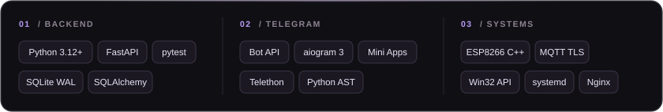

 

&nbsp;&nbsp;&nbsp;&nbsp;

### Проекты

<table width="100%">
  <tr>
    <td width="50%" valign="top">
      <a href="https://github.com/W1bbex/pc-control"><strong>PC Control</strong></a> &nbsp;·&nbsp; <a href="https://w1bbex.ru/ru/pc-control/">Кейс ↗</a> 
      Управление ПК до входа в Windows: ATX-реле, замок Морзе, Winlogon и MQTT TLS  
      <code>Python</code> <code>ESP8266</code> <code>Win32</code> <code>MQTT TLS</code>
    </td>
    <td width="50%" valign="top">
      <a href="https://github.com/W1bbex/tg-flowmap"><strong>TG-FlowMap</strong></a> &nbsp;·&nbsp; <a href="https://pypi.org/project/tg-flowmap/">PyPI ↗</a> 
      Статический (Python AST) и динамический (Telethon) маппер экранов Telegram-ботов  
      <code>Python AST</code> <code>Telethon</code> <code>SVG</code>
    </td>
  </tr>
  <tr>
    <td width="50%" valign="top">
      <a href="https://github.com/W1bbex/fpc-plugins"><strong>FPC Plugins</strong></a> 
      Модульные плагины для FunPay Cardinal: AutoSMM и W1bbex&nbsp;Hub с автообновлением  
      <code>Python</code> <code>FastAPI</code> <code>Cython</code>
    </td>
    <td width="50%" valign="top">
      <a href="https://github.com/W1bbex/nail-booking-bot"><strong>Nail Atelier</strong></a> &nbsp;·&nbsp; <a href="https://t.me/NailsAtelier_app">Демо ↗</a> 
      Онлайн-запись и расписание салона: Telegram-бот и Mini App с админкой и RBAC  
      <code>aiogram 3</code> <code>FastAPI</code> <code>SQLAlchemy</code>
    </td>
  </tr>
  <tr>
    <td width="50%" valign="top">
      <a href="https://github.com/W1bbex/w1x-cli"><strong>W1x CLI</strong></a> &nbsp;·&nbsp; <a href="https://pypi.org/project/w1x-cli/">PyPI ↗</a> 
      Терминальный клиент для локальных моделей Ollama с поиском, REPL и памятью  
      <code>Python</code> <code>Ollama</code> <code>Rich</code>
    </td>
    <td width="50%" valign="top">
      <a href="https://github.com/W1bbex/funpay-parser"><strong>FunPay Parser</strong></a> 
      Асинхронный ETL-скрапер лотов, отзывов и продавцов с immutable raw-слоем  
      <code>Python</code> <code>asyncio</code> <code>SQLite WAL</code>
    </td>
  </tr>
</table>

### Стек

 

<strong>English version</strong>

 

<table width="100%">
  <tr>
    <td width="50%" valign="top">
      <a href="https://github.com/W1bbex/pc-control"><strong>PC Control</strong></a> &nbsp;·&nbsp; <a href="https://w1bbex.ru/en/pc-control/">Case ↗</a> 
      Out-of-band power &amp; remote Windows unlock across Session 0 with ATX relay and MQTT TLS  
      <code>Python</code> <code>ESP8266</code> <code>Win32</code> <code>MQTT TLS</code>
    </td>
    <td width="50%" valign="top">
      <a href="https://github.com/W1bbex/tg-flowmap"><strong>TG-FlowMap</strong></a> &nbsp;·&nbsp; <a href="https://pypi.org/project/tg-flowmap/">PyPI ↗</a> 
      Static AST (SAST) + Telethon crawler (DAST) screen mapper for Telegram bots  
      <code>Python AST</code> <code>Telethon</code> <code>SVG</code>
    </td>
  </tr>
  <tr>
    <td width="50%" valign="top">
      <a href="https://github.com/W1bbex/fpc-plugins"><strong>FPC Plugins</strong></a> 
      Modular FunPay Cardinal plugins: AutoSMM and W1bbex&nbsp;Hub with auto-updates  
      <code>Python</code> <code>FastAPI</code> <code>Cython</code>
    </td>
    <td width="50%" valign="top">
      <a href="https://github.com/W1bbex/nail-booking-bot"><strong>Nail Atelier</strong></a> &nbsp;·&nbsp; <a href="https://t.me/NailsAtelier_app">Demo ↗</a> 
      Beauty studio booking Telegram bot &amp; Mini App with admin panel and RBAC  
      <code>aiogram 3</code> <code>FastAPI</code> <code>SQLAlchemy</code>
    </td>
  </tr>
  <tr>
    <td width="50%" valign="top">
      <a href="https://github.com/W1bbex/w1x-cli"><strong>W1x CLI</strong></a> &nbsp;·&nbsp; <a href="https://pypi.org/project/w1x-cli/">PyPI ↗</a> 
      Keyboard-first CLI client for local Ollama models with tool calling and persistent memory  
      <code>Python</code> <code>Ollama</code> <code>Rich</code>
    </td>
    <td width="50%" valign="top">
      <a href="https://github.com/W1bbex/funpay-parser"><strong>FunPay Parser</strong></a> 
      Asynchronous ETL scraper and seller/listing analytics on SQLite WAL  
      <code>Python</code> <code>asyncio</code> <code>SQLite WAL</code>
    </td>
  </tr>
</table>

